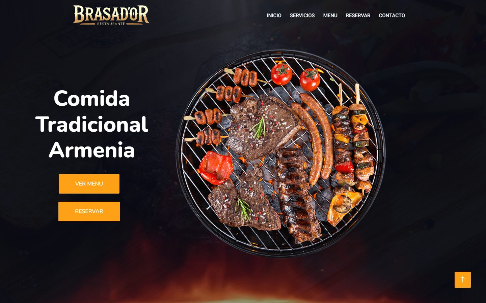
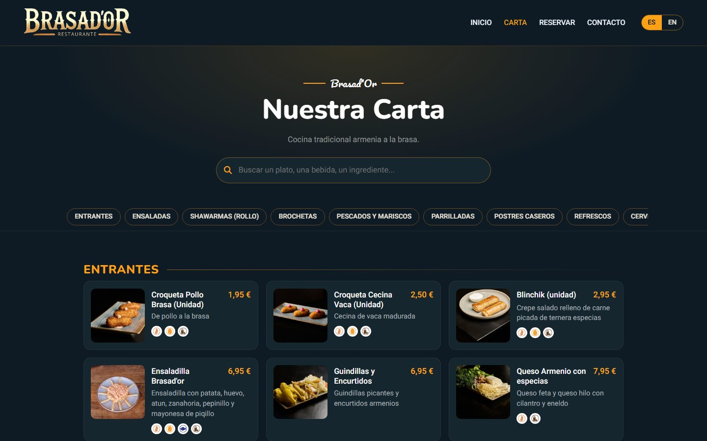
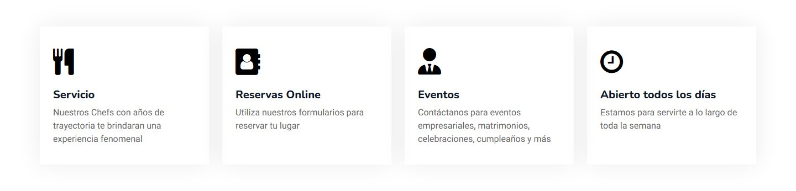
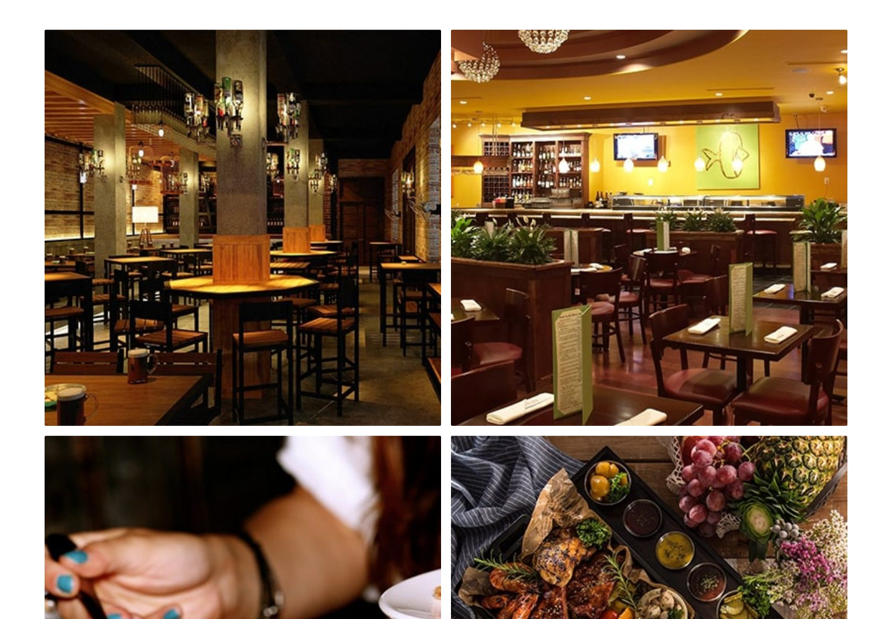
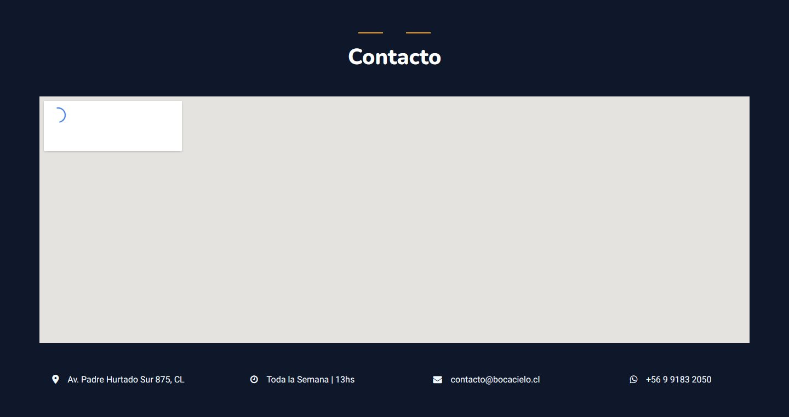
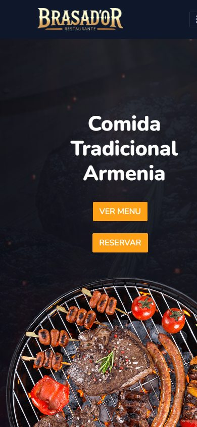
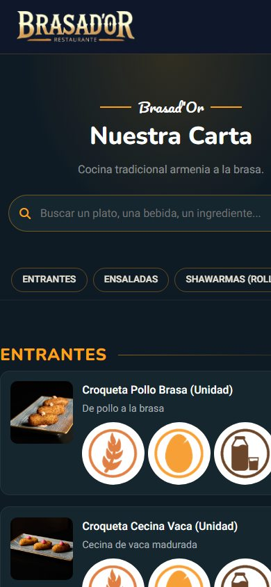

# Brasad'Or

The website of **Brasad'Or**, a restaurant in Spain serving traditional Armenian food: grilled meats, skewers and the dishes of the house. One page in Spanish for the restaurant, its services, bookings and contact, plus its **menu**, kept online by the restaurant itself from an admin panel. Live at **[kazin.dev/projects/brasador](https://kazin.dev/projects/brasador/)**.

Built in 2025 by [Elias Lujan (Kazin)](https://kazin.dev) on a free HTML Codex template; the menu system added in 2026.

[](https://kazin.dev/projects/brasador/)

## What a visitor meets

- **Landing**: the restaurant's logo, "Comida Tradicional Armenia" over a looping video of the grill, two calls to action: see the menu, book a table.
- **Carta** (`menu.html`): the whole menu, 11 categories and 164 dishes and drinks with photos, descriptions, prices (several per item where the restaurant sells sizes, like a caña and a pint), the allergens of each dish with the legal icons and a legend. A search box finds a dish, a drink or an ingredient; a sticky bar jumps to a category; Spanish and English with one tap; tap a photo to see it large. Made to be read on a phone at the table.
- **Servicios**: open every day, events, online bookings, table service.
- **Reservar**: the booking form (date, time, number of guests, a note).
- **Contacto**: the address, a WhatsApp link, the map, and the social links.

## What the restaurant can do

- **Edit the menu online** at `admin/`, with a password: add, rename, reorder or remove categories and subcategories; add dishes with name and description in Spanish and English, a price or a list of formats with their prices, the allergens, a photo (uploaded from the phone, resized on the server), and mark a dish as unavailable without deleting it.
- Every save publishes at once and keeps a copy of the previous menu (the last thirty, in `data/backups/`).

## Screenshots

Taken from the live site on 2026-11-06.

| | |
|---|---|
| [](docs/screenshots/menu-1440.jpg) The menu | [](docs/screenshots/services-1440.jpg) Services |
| [](docs/screenshots/reserve-1440.jpg) Gallery | [](docs/screenshots/contact-1440.jpg) Contact |

<p>
  
  
</p>

## What runs behind it

- **Static HTML** for the pages: `index.html` and `menu.html` with their CSS, fonts, images and scripts; the video is a local WebM.
- **The menu is one JSON file** (`data/menu.json`): categories, items, prices, formats, allergens, photos, texts in `es` and `en`. `js/menu.js` fetches it and renders the page in the browser, so a saved change is live on the next load, with no build and no database.
- **PHP for the editing**, through php-fpm: `api/menu.php` (GET the menu; POST it back, validated field by field, written atomically after a backup), `api/upload.php` (photos checked as images and re-encoded to JPEG, at most 1200 px), `admin/index.php` (the editor: a session after a password check with `password_verify`, 8 wrong tries lock it for 15 minutes, a CSRF token on every write, HttpOnly / Secure / SameSite cookie).
- **Nothing secret in the repository**: the password hash lives in `private/config.php` on the server, outside the served folder; the live menu and the uploads live outside the deployed files too and survive every deploy.
- **Bootstrap 5**, **jQuery 3.4**, **Owl Carousel**, **WOW.js** with `animate.css`, Waypoints and CounterUp, Tempus Dominus, **Font Awesome**, Google Fonts (Heebo, Nunito, Pacifico). Template: HTML Codex's free restaurant template, CC BY 4.0; the author's credit is kept as the license asks.

## Deploying

`deploy.ps1` packs the site, copies it to the Ubuntu box (ssh alias `kazin-music`) and runs `deploy/install.sh` there: the files to `/opt/brasador-web/web`, the live menu and uploads kept in `/opt/brasador-web/data` and `/opt/brasador-web/uploads`, the administrator password made on the first install (shown once, kept in `/etc/brasador-web/admin.txt`), the Caddy snippet under kazin.dev. The old address `kazin.dev/brasador-web` redirects to the new one.

```powershell
powershell -ExecutionPolicy Bypass -File deploy.ps1
```

To try the panel locally: `private/README.md`.

## Layout

```
index.html                 the site;  menu.html  the menu page
css/menu.css, js/menu.js   the menu page's look and rendering
data/menu.json             the menu (the repository's copy seeds the server's on the first install)
img/menu/                  the dishes' photos;  img/allergens/  the 16 allergen icons;  img/uploads/  photos added from the panel (server)
api/common.php, menu.php, upload.php   the menu API
admin/index.php, admin.js, admin.css   the editor
private/                   config.php with the password hash (server only, git-ignored)
css/, js/main.js, lib/, img/, fonts/   the template's styles, behaviour, libraries, photos, the hero video
deploy.ps1, deploy/        publishing: install.sh, brasador-web.caddy
docs/screenshots/          the screenshots above
```

## History

- **2025-11-02**: first version of the site; the menu was a link to an external smart-menu service.
- **2026-10-18**: published on the Ubuntu box at kazin.dev/brasador-web with a one-command deploy.
- **2026-11-06**: moved to kazin.dev/projects/brasador; the repository renamed to brasador.restaurant.website. The menu brought into the site (imported from the smart menu: every category, item, price, allergen and photo) with its own page and the admin panel.
